# Japanese LP design systems for AI coding agents — DESIGN.md pattern packs

Japanese landing-page design systems (DESIGN.md) for AI coding agents — synthesised from 1,396 public LP analyses.

[日本語](README.ja.md) · [designmark.jp](https://designmark.jp/?utm_source=github&utm_medium=readme&utm_campaign=packs) · Packs: CC BY 4.0 · Scripts: MIT

Each **pattern pack** is a single `DESIGN.md` for one industry × main mood: colour tokens, type scale, spacing, radii, components, section order and do's & don'ts, in a format that AI coding tools such as Claude Code, Cursor and v0 can follow to build a landing page in the same tone and manner.

## Use

```bash
npx designmark add pk-cosmetics-cute    # saves the pack's DESIGN.md into your project
```

- Or copy `packs/<id>/DESIGN.md` to your project root and add the line `@DESIGN.md` to `CLAUDE.md`.
- Claude Code plugin: `/plugin marketplace add xecin-inc/designmark` → `/plugin install designmark@designmark` ([tools](https://github.com/xecin-inc/designmark))

## Packs (33)

| Industry | Mood | Preview | Based on | Files |
|---|---|---|---|---|
| Cosmetics & skincare<br>化粧品・スキンケア | Cute<br>かわいい | <a href="packs/pk-cosmetics-cute/preview.png">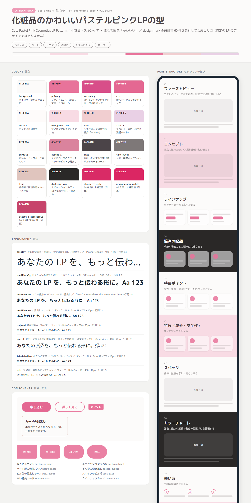</a> | 60 LP analyses | [DESIGN.md](packs/pk-cosmetics-cute/DESIGN.md) · [preview](packs/pk-cosmetics-cute/preview.html) · [page](https://designmark.jp/packs/pk-cosmetics-cute/?utm_source=github&utm_medium=readme&utm_campaign=packs)<br>`pk-cosmetics-cute` |
| Cosmetics & skincare<br>化粧品・スキンケア | Elegant & premium<br>上品・高級 | <a href="packs/pk-cosmetics-elegant/preview.png">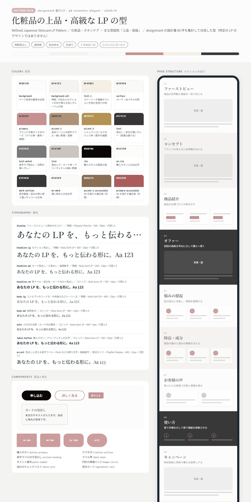</a> | 60 LP analyses | [DESIGN.md](packs/pk-cosmetics-elegant/DESIGN.md) · [preview](packs/pk-cosmetics-elegant/preview.html) · [page](https://designmark.jp/packs/pk-cosmetics-elegant/?utm_source=github&utm_medium=readme&utm_campaign=packs)<br>`pk-cosmetics-elegant` |
| Hair & body care<br>ヘアケア・ボディケア | Elegant & premium<br>上品・高級 | <a href="packs/pk-haircare-elegant/preview.png">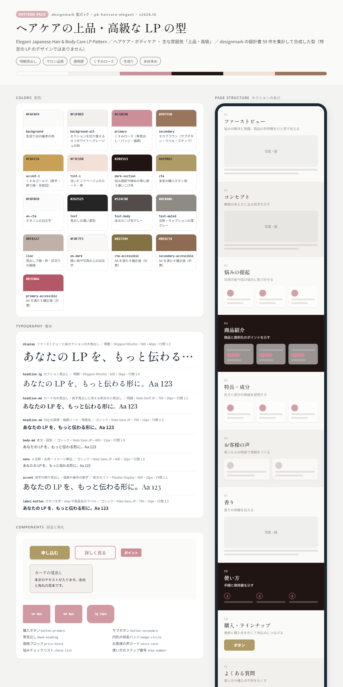</a> | 59 LP analyses | [DESIGN.md](packs/pk-haircare-elegant/DESIGN.md) · [preview](packs/pk-haircare-elegant/preview.html) · [page](https://designmark.jp/packs/pk-haircare-elegant/?utm_source=github&utm_medium=readme&utm_campaign=packs)<br>`pk-haircare-elegant` |
| Hair & body care<br>ヘアケア・ボディケア | Clean & fresh<br>清潔・爽やか | <a href="packs/pk-haircare-fresh/preview.png">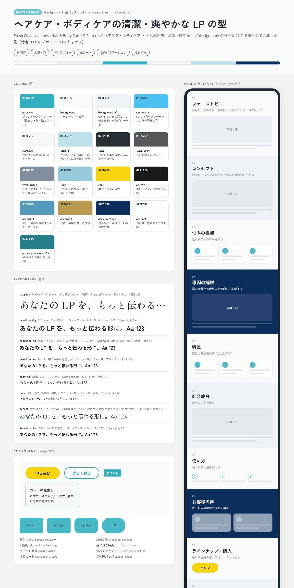</a> | 22 LP analyses | [DESIGN.md](packs/pk-haircare-fresh/DESIGN.md) · [preview](packs/pk-haircare-fresh/preview.html) · [page](https://designmark.jp/packs/pk-haircare-fresh/?utm_source=github&utm_medium=readme&utm_campaign=packs)<br>`pk-haircare-fresh` |
| Health foods & supplements<br>健康食品・サプリメント | Information-rich<br>情報量多め・訴求型 | <a href="packs/pk-supplements-dense/preview.png">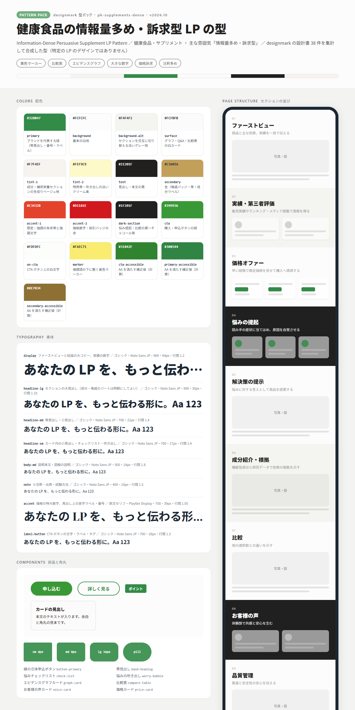</a> | 38 LP analyses | [DESIGN.md](packs/pk-supplements-dense/DESIGN.md) · [preview](packs/pk-supplements-dense/preview.html) · [page](https://designmark.jp/packs/pk-supplements-dense/?utm_source=github&utm_medium=readme&utm_campaign=packs)<br>`pk-supplements-dense` |
| Health foods & supplements<br>健康食品・サプリメント | Elegant & premium<br>上品・高級 | <a href="packs/pk-supplements-elegant/preview.png">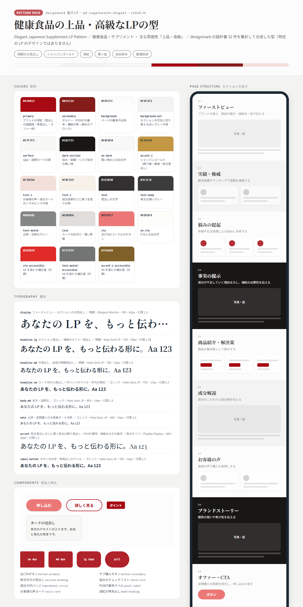</a> | 32 LP analyses | [DESIGN.md](packs/pk-supplements-elegant/DESIGN.md) · [preview](packs/pk-supplements-elegant/preview.html) · [page](https://designmark.jp/packs/pk-supplements-elegant/?utm_source=github&utm_medium=readme&utm_campaign=packs)<br>`pk-supplements-elegant` |
| Food & beverages<br>食品・飲料 | Pop & energetic<br>ポップ・元気 | <a href="packs/pk-food-pop/preview.png">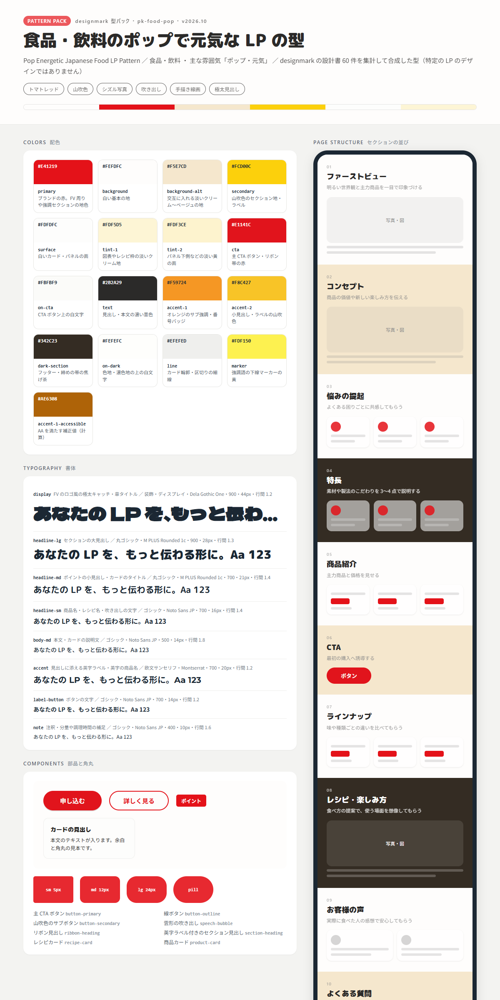</a> | 60 LP analyses | [DESIGN.md](packs/pk-food-pop/DESIGN.md) · [preview](packs/pk-food-pop/preview.html) · [page](https://designmark.jp/packs/pk-food-pop/?utm_source=github&utm_medium=readme&utm_campaign=packs)<br>`pk-food-pop` |
| Food & beverages<br>食品・飲料 | Natural<br>ナチュラル | <a href="packs/pk-food-natural/preview.png">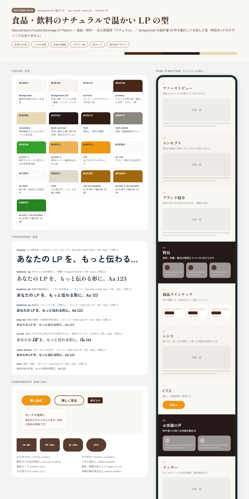</a> | 30 LP analyses | [DESIGN.md](packs/pk-food-natural/DESIGN.md) · [preview](packs/pk-food-natural/preview.html) · [page](https://designmark.jp/packs/pk-food-natural/?utm_source=github&utm_medium=readme&utm_campaign=packs)<br>`pk-food-natural` |
| Sweets & desserts<br>菓子・スイーツ | Elegant & premium<br>上品・高級 | <a href="packs/pk-sweets-elegant/preview.png">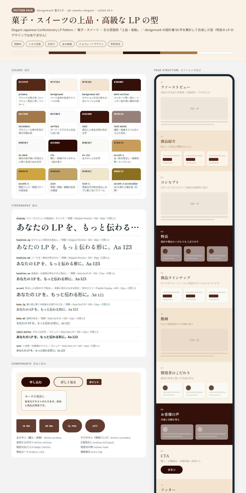</a> | 60 LP analyses | [DESIGN.md](packs/pk-sweets-elegant/DESIGN.md) · [preview](packs/pk-sweets-elegant/preview.html) · [page](https://designmark.jp/packs/pk-sweets-elegant/?utm_source=github&utm_medium=readme&utm_campaign=packs)<br>`pk-sweets-elegant` |
| Sweets & desserts<br>菓子・スイーツ | Pop & energetic<br>ポップ・元気 | <a href="packs/pk-sweets-pop/preview.png">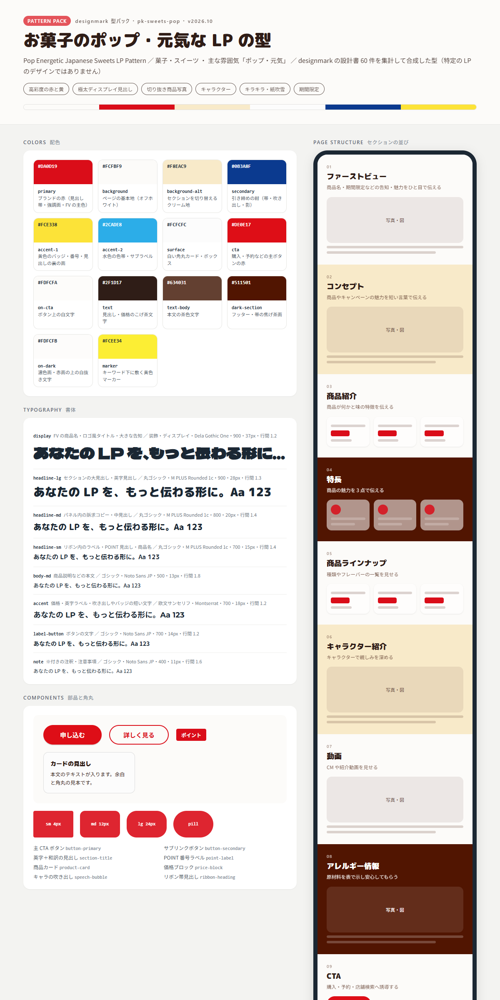</a> | 60 LP analyses | [DESIGN.md](packs/pk-sweets-pop/DESIGN.md) · [preview](packs/pk-sweets-pop/preview.html) · [page](https://designmark.jp/packs/pk-sweets-pop/?utm_source=github&utm_medium=readme&utm_campaign=packs)<br>`pk-sweets-pop` |
| Alcoholic beverages<br>酒類 | Pop & energetic<br>ポップ・元気 | <a href="packs/pk-alcohol-pop/preview.png">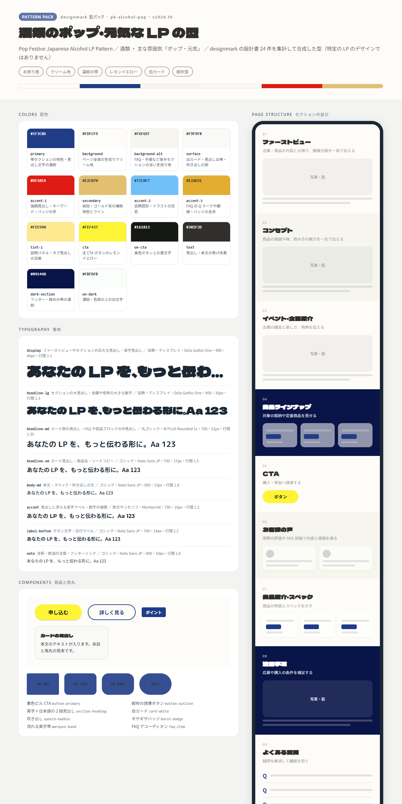</a> | 24 LP analyses | [DESIGN.md](packs/pk-alcohol-pop/DESIGN.md) · [preview](packs/pk-alcohol-pop/preview.html) · [page](https://designmark.jp/packs/pk-alcohol-pop/?utm_source=github&utm_medium=readme&utm_campaign=packs)<br>`pk-alcohol-pop` |
| Fashion & accessories<br>ファッション・アクセサリー | Elegant & premium<br>上品・高級 | <a href="packs/pk-fashion-elegant/preview.png">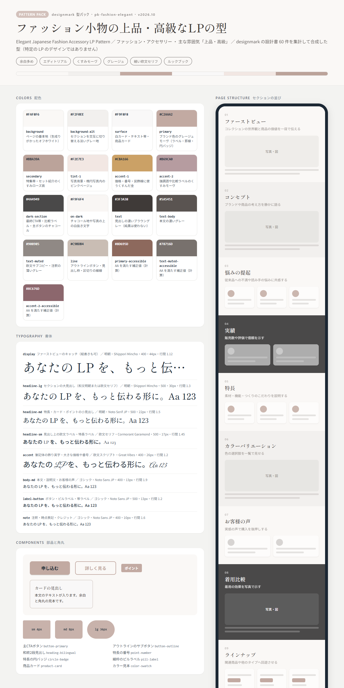</a> | 60 LP analyses | [DESIGN.md](packs/pk-fashion-elegant/DESIGN.md) · [preview](packs/pk-fashion-elegant/preview.html) · [page](https://designmark.jp/packs/pk-fashion-elegant/?utm_source=github&utm_medium=readme&utm_campaign=packs)<br>`pk-fashion-elegant` |
| Fashion & accessories<br>ファッション・アクセサリー | Cute<br>かわいい | <a href="packs/pk-fashion-cute/preview.png">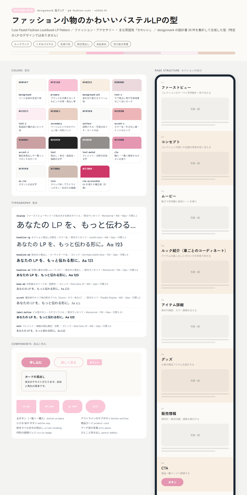</a> | 39 LP analyses | [DESIGN.md](packs/pk-fashion-cute/DESIGN.md) · [preview](packs/pk-fashion-cute/preview.html) · [page](https://designmark.jp/packs/pk-fashion-cute/?utm_source=github&utm_medium=readme&utm_campaign=packs)<br>`pk-fashion-cute` |
| Electronics & gadgets<br>家電・ガジェット | Elegant & premium<br>上品・高級 | <a href="packs/pk-gadgets-elegant/preview.png">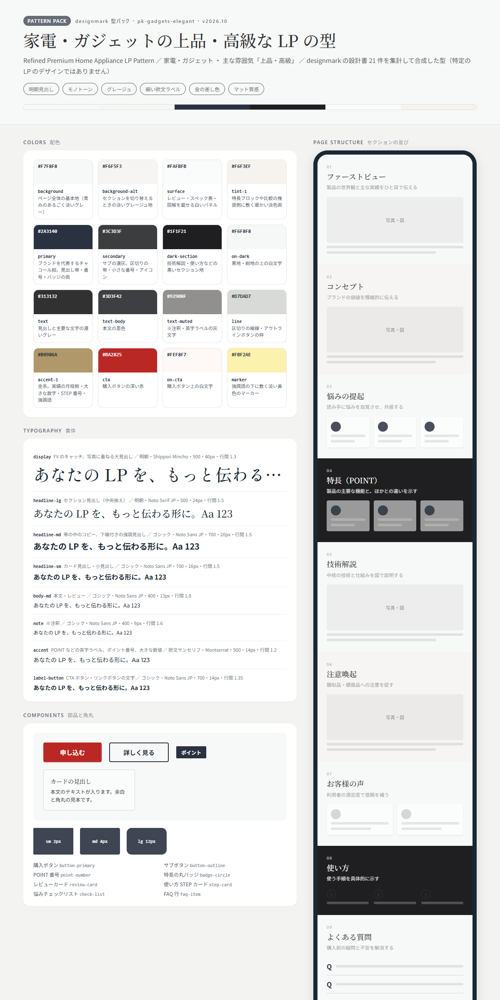</a> | 21 LP analyses | [DESIGN.md](packs/pk-gadgets-elegant/DESIGN.md) · [preview](packs/pk-gadgets-elegant/preview.html) · [page](https://designmark.jp/packs/pk-gadgets-elegant/?utm_source=github&utm_medium=readme&utm_campaign=packs)<br>`pk-gadgets-elegant` |
| Housing & real estate<br>住宅・不動産・リフォーム | Elegant & premium<br>上品・高級 | <a href="packs/pk-real-estate-elegant/preview.png">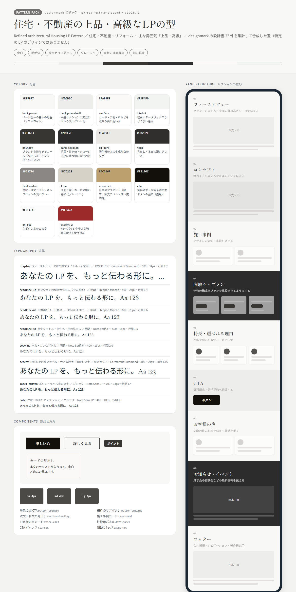</a> | 23 LP analyses | [DESIGN.md](packs/pk-real-estate-elegant/DESIGN.md) · [preview](packs/pk-real-estate-elegant/preview.html) · [page](https://designmark.jp/packs/pk-real-estate-elegant/?utm_source=github&utm_medium=readme&utm_campaign=packs)<br>`pk-real-estate-elegant` |
| Finance & insurance<br>金融・保険 | Trustworthy<br>信頼・誠実 | <a href="packs/pk-finance-trust/preview.png">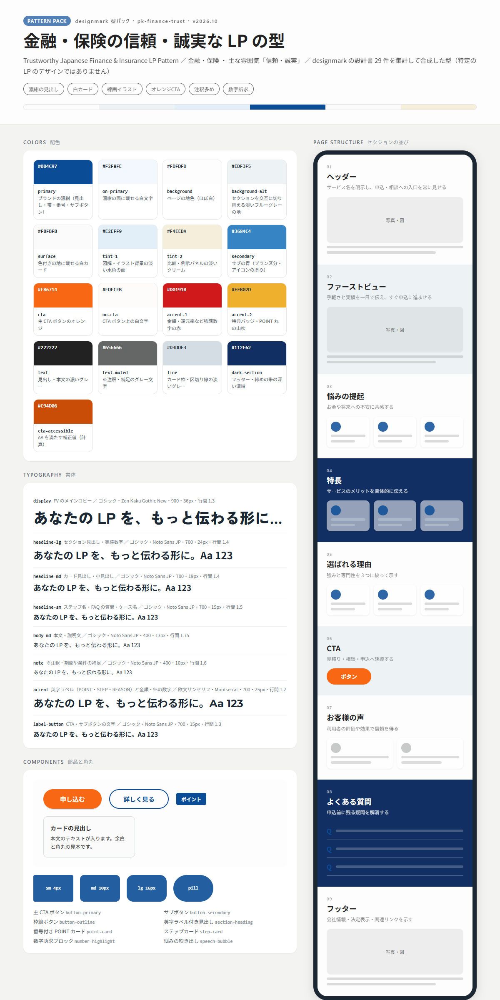</a> | 29 LP analyses | [DESIGN.md](packs/pk-finance-trust/DESIGN.md) · [preview](packs/pk-finance-trust/preview.html) · [page](https://designmark.jp/packs/pk-finance-trust/?utm_source=github&utm_medium=readme&utm_campaign=packs)<br>`pk-finance-trust` |
| Finance & insurance<br>金融・保険 | Pop & energetic<br>ポップ・元気 | <a href="packs/pk-finance-pop/preview.png">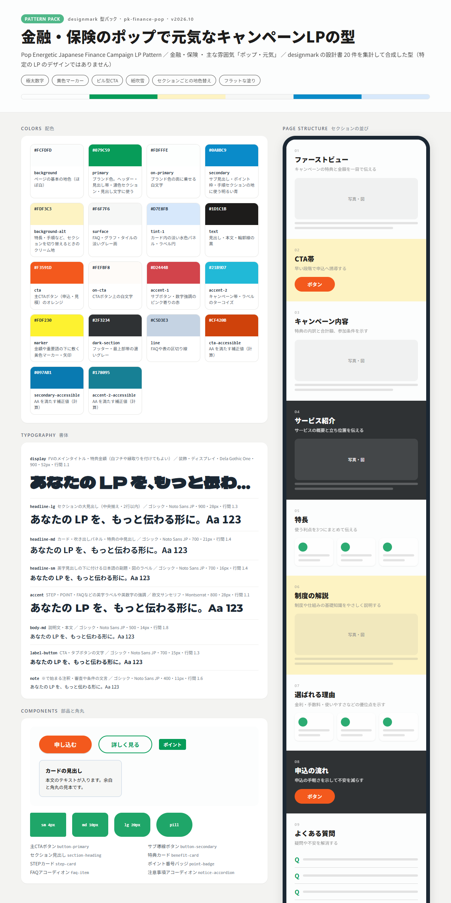</a> | 20 LP analyses | [DESIGN.md](packs/pk-finance-pop/DESIGN.md) · [preview](packs/pk-finance-pop/preview.html) · [page](https://designmark.jp/packs/pk-finance-pop/?utm_source=github&utm_medium=readme&utm_campaign=packs)<br>`pk-finance-pop` |
| Education & schools<br>教育・スクール・資格 | Pop & energetic<br>ポップ・元気 | <a href="packs/pk-education-pop/preview.png">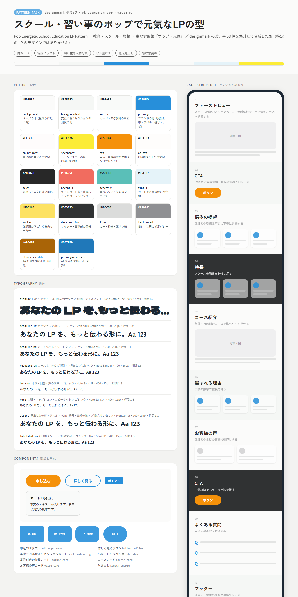</a> | 58 LP analyses | [DESIGN.md](packs/pk-education-pop/DESIGN.md) · [preview](packs/pk-education-pop/preview.html) · [page](https://designmark.jp/packs/pk-education-pop/?utm_source=github&utm_medium=readme&utm_campaign=packs)<br>`pk-education-pop` |
| Education & schools<br>教育・スクール・資格 | Trustworthy<br>信頼・誠実 | <a href="packs/pk-education-trust/preview.png">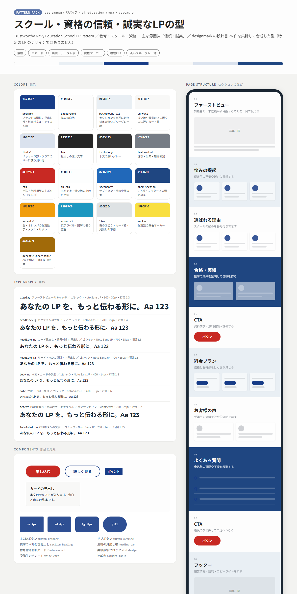</a> | 26 LP analyses | [DESIGN.md](packs/pk-education-trust/DESIGN.md) · [preview](packs/pk-education-trust/preview.html) · [page](https://designmark.jp/packs/pk-education-trust/?utm_source=github&utm_medium=readme&utm_campaign=packs)<br>`pk-education-trust` |
| Recruiting<br>求人・採用 | Pop & energetic<br>ポップ・元気 | <a href="packs/pk-recruiting-pop/preview.png">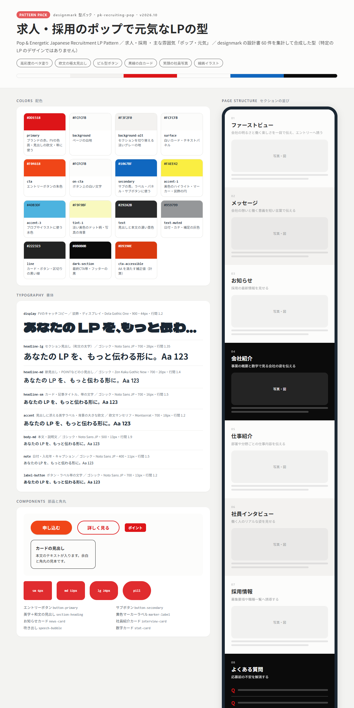</a> | 60 LP analyses | [DESIGN.md](packs/pk-recruiting-pop/DESIGN.md) · [preview](packs/pk-recruiting-pop/preview.html) · [page](https://designmark.jp/packs/pk-recruiting-pop/?utm_source=github&utm_medium=readme&utm_campaign=packs)<br>`pk-recruiting-pop` |
| Recruiting<br>求人・採用 | Trustworthy<br>信頼・誠実 | <a href="packs/pk-recruiting-trust/preview.png">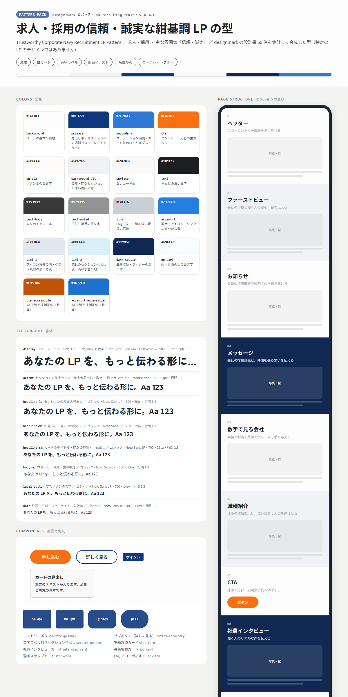</a> | 60 LP analyses | [DESIGN.md](packs/pk-recruiting-trust/DESIGN.md) · [preview](packs/pk-recruiting-trust/preview.html) · [page](https://designmark.jp/packs/pk-recruiting-trust/?utm_source=github&utm_medium=readme&utm_campaign=packs)<br>`pk-recruiting-trust` |
| B2B, SaaS & IT services<br>BtoB・SaaS・ITサービス | Trustworthy<br>信頼・誠実 | <a href="packs/pk-btob-saas-trust/preview.png">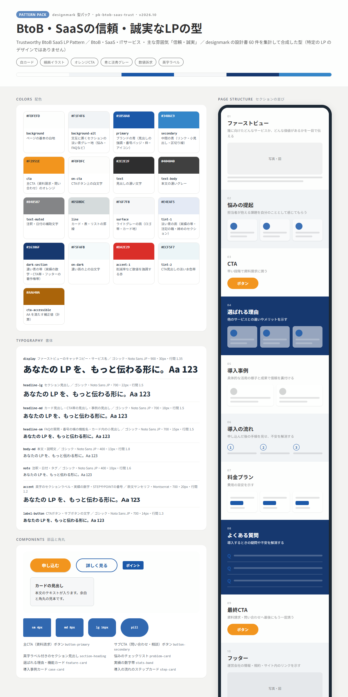</a> | 60 LP analyses | [DESIGN.md](packs/pk-btob-saas-trust/DESIGN.md) · [preview](packs/pk-btob-saas-trust/preview.html) · [page](https://designmark.jp/packs/pk-btob-saas-trust/?utm_source=github&utm_medium=readme&utm_campaign=packs)<br>`pk-btob-saas-trust` |
| B2B, SaaS & IT services<br>BtoB・SaaS・ITサービス | Clean & fresh<br>清潔・爽やか | <a href="packs/pk-btob-saas-fresh/preview.png">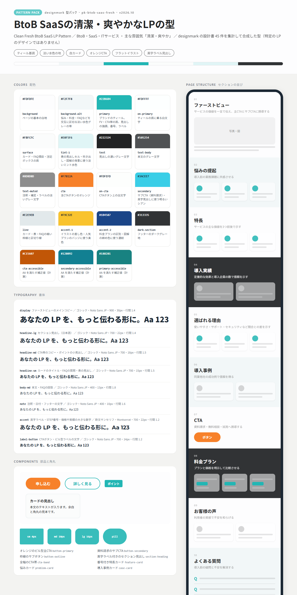</a> | 45 LP analyses | [DESIGN.md](packs/pk-btob-saas-fresh/DESIGN.md) · [preview](packs/pk-btob-saas-fresh/preview.html) · [page](https://designmark.jp/packs/pk-btob-saas-fresh/?utm_source=github&utm_medium=readme&utm_campaign=packs)<br>`pk-btob-saas-fresh` |
| Medical & healthcare<br>医療・クリニック・ヘルスケア | Soft & gentle<br>やさしい・柔らかい | <a href="packs/pk-medical-soft/preview.png">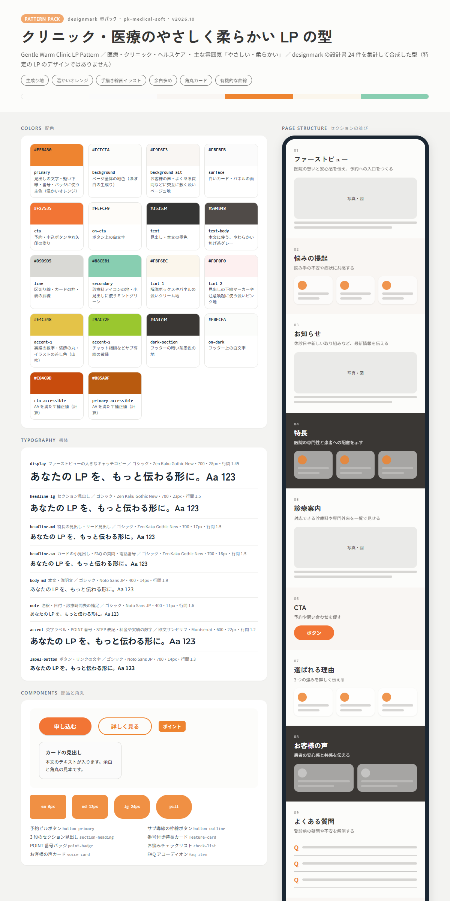</a> | 24 LP analyses | [DESIGN.md](packs/pk-medical-soft/DESIGN.md) · [preview](packs/pk-medical-soft/preview.html) · [page](https://designmark.jp/packs/pk-medical-soft/?utm_source=github&utm_medium=readme&utm_campaign=packs)<br>`pk-medical-soft` |
| Medical & healthcare<br>医療・クリニック・ヘルスケア | Trustworthy<br>信頼・誠実 | <a href="packs/pk-medical-trust/preview.png">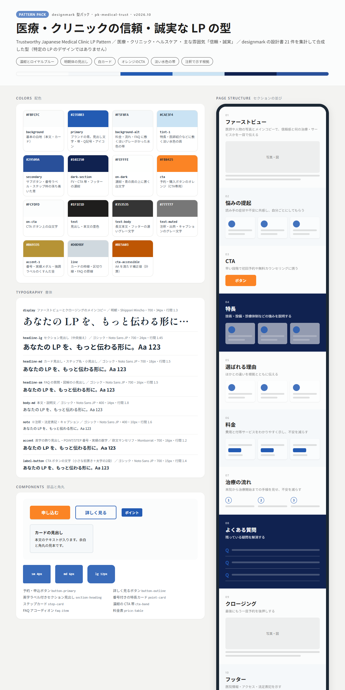</a> | 21 LP analyses | [DESIGN.md](packs/pk-medical-trust/DESIGN.md) · [preview](packs/pk-medical-trust/preview.html) · [page](https://designmark.jp/packs/pk-medical-trust/?utm_source=github&utm_medium=readme&utm_campaign=packs)<br>`pk-medical-trust` |
| Travel & hotels<br>旅行・観光・ホテル | Pop & energetic<br>ポップ・元気 | <a href="packs/pk-travel-pop/preview.png">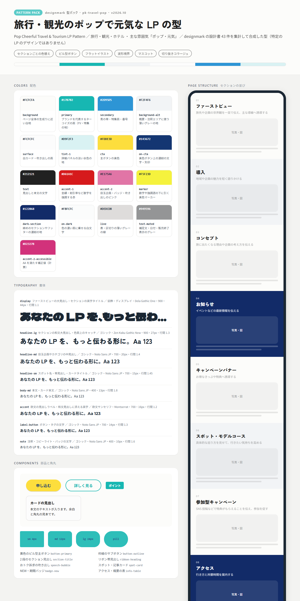</a> | 43 LP analyses | [DESIGN.md](packs/pk-travel-pop/DESIGN.md) · [preview](packs/pk-travel-pop/preview.html) · [page](https://designmark.jp/packs/pk-travel-pop/?utm_source=github&utm_medium=readme&utm_campaign=packs)<br>`pk-travel-pop` |
| Travel & hotels<br>旅行・観光・ホテル | Japanese traditional<br>和風 | <a href="packs/pk-travel-wafu/preview.png">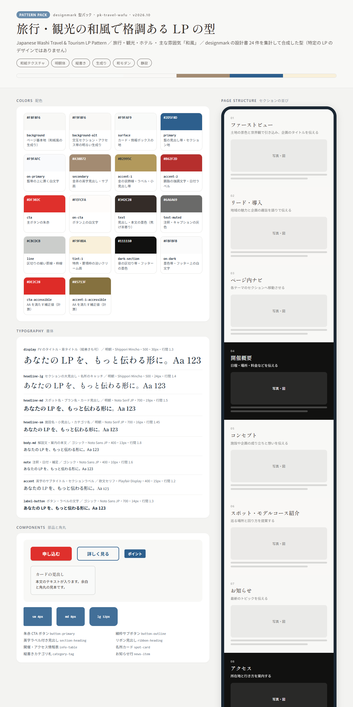</a> | 24 LP analyses | [DESIGN.md](packs/pk-travel-wafu/DESIGN.md) · [preview](packs/pk-travel-wafu/preview.html) · [page](https://designmark.jp/packs/pk-travel-wafu/?utm_source=github&utm_medium=readme&utm_campaign=packs)<br>`pk-travel-wafu` |
| Restaurants<br>飲食店・レストラン | Elegant & premium<br>上品・高級 | <a href="packs/pk-restaurant-elegant/preview.png">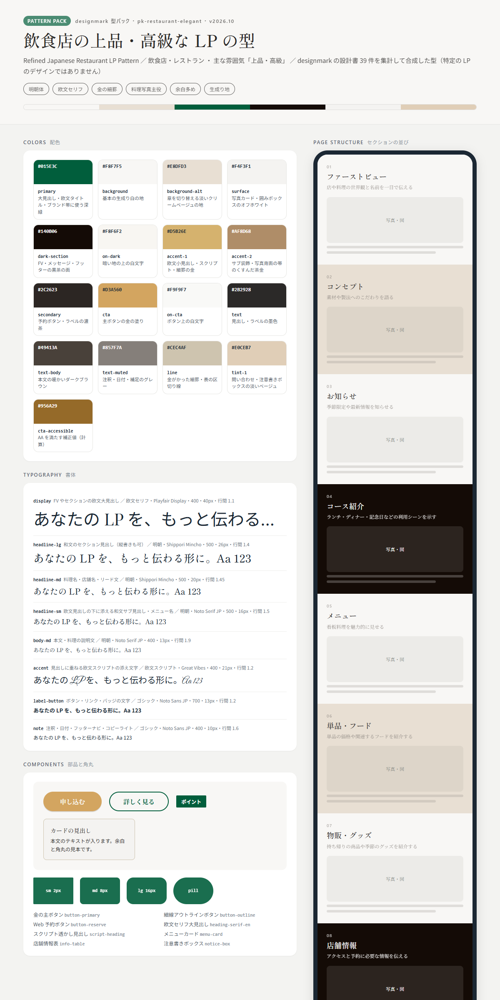</a> | 39 LP analyses | [DESIGN.md](packs/pk-restaurant-elegant/DESIGN.md) · [preview](packs/pk-restaurant-elegant/preview.html) · [page](https://designmark.jp/packs/pk-restaurant-elegant/?utm_source=github&utm_medium=readme&utm_campaign=packs)<br>`pk-restaurant-elegant` |
| Restaurants<br>飲食店・レストラン | Japanese traditional<br>和風 | <a href="packs/pk-restaurant-wafu/preview.png">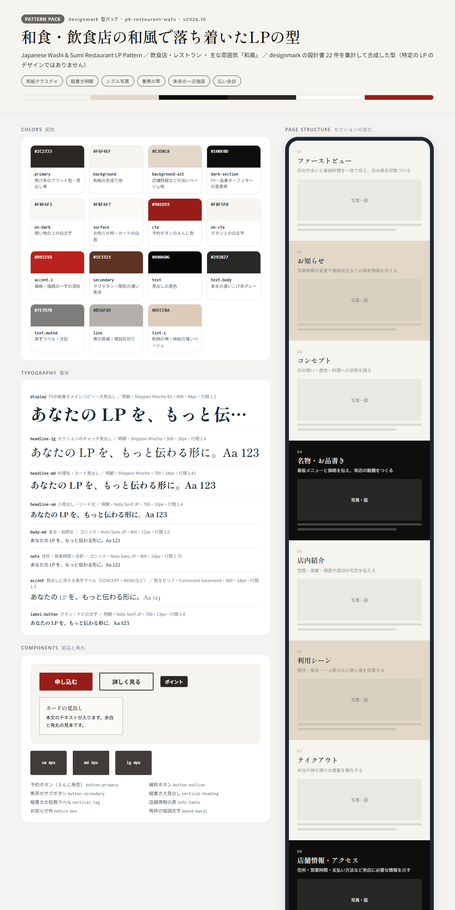</a> | 22 LP analyses | [DESIGN.md](packs/pk-restaurant-wafu/DESIGN.md) · [preview](packs/pk-restaurant-wafu/preview.html) · [page](https://designmark.jp/packs/pk-restaurant-wafu/?utm_source=github&utm_medium=readme&utm_campaign=packs)<br>`pk-restaurant-wafu` |
| Entertainment, games & apps<br>エンタメ・ゲーム・アプリ | Dark luxury<br>ラグジュアリー・ダーク | <a href="packs/pk-entertainment-dark-luxury/preview.png">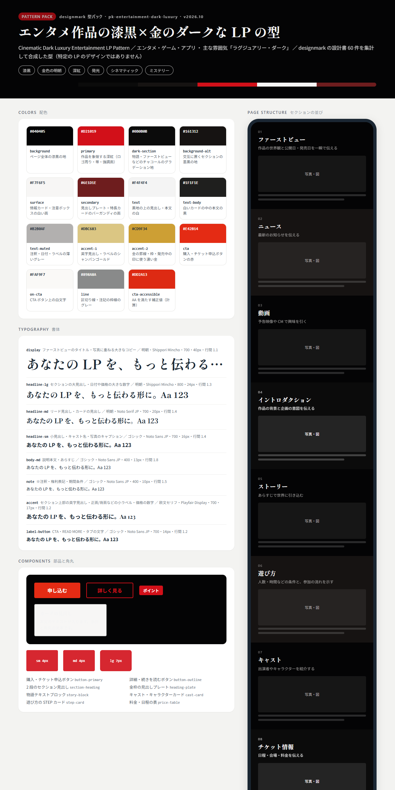</a> | 60 LP analyses | [DESIGN.md](packs/pk-entertainment-dark-luxury/DESIGN.md) · [preview](packs/pk-entertainment-dark-luxury/preview.html) · [page](https://designmark.jp/packs/pk-entertainment-dark-luxury/?utm_source=github&utm_medium=readme&utm_campaign=packs)<br>`pk-entertainment-dark-luxury` |
| Entertainment, games & apps<br>エンタメ・ゲーム・アプリ | Pop & energetic<br>ポップ・元気 | <a href="packs/pk-entertainment-pop/preview.png">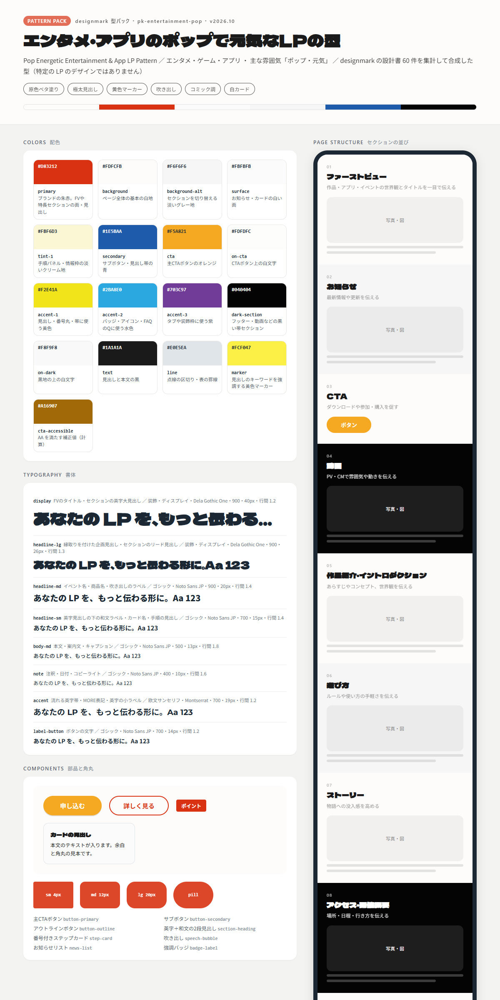</a> | 60 LP analyses | [DESIGN.md](packs/pk-entertainment-pop/DESIGN.md) · [preview](packs/pk-entertainment-pop/preview.html) · [page](https://designmark.jp/packs/pk-entertainment-pop/?utm_source=github&utm_medium=readme&utm_campaign=packs)<br>`pk-entertainment-pop` |
| Campaigns & giveaways<br>キャンペーン・プレゼント | Pop & energetic<br>ポップ・元気 | <a href="packs/pk-campaign-pop/preview.png">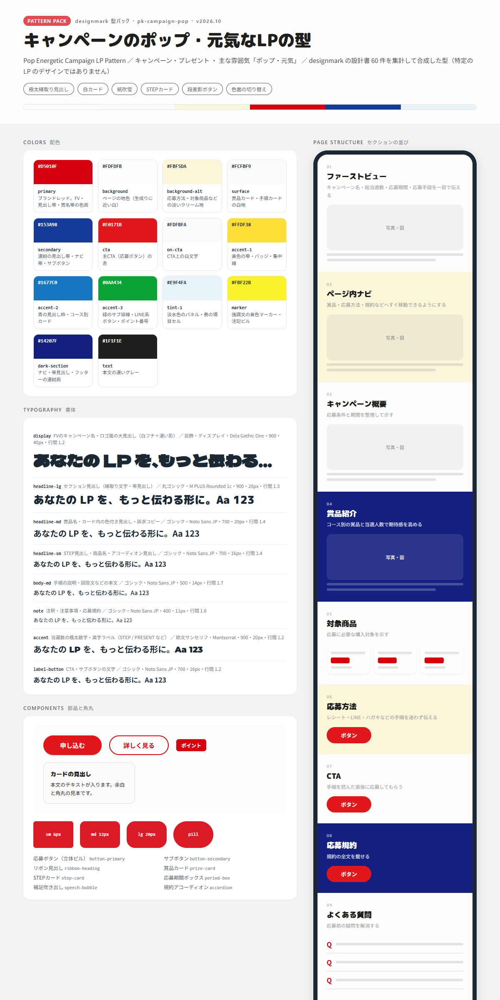</a> | 60 LP analyses | [DESIGN.md](packs/pk-campaign-pop/DESIGN.md) · [preview](packs/pk-campaign-pop/preview.html) · [page](https://designmark.jp/packs/pk-campaign-pop/?utm_source=github&utm_medium=readme&utm_campaign=packs)<br>`pk-campaign-pop` |
| Campaigns & giveaways<br>キャンペーン・プレゼント | Cute<br>かわいい | <a href="packs/pk-campaign-cute/preview.png">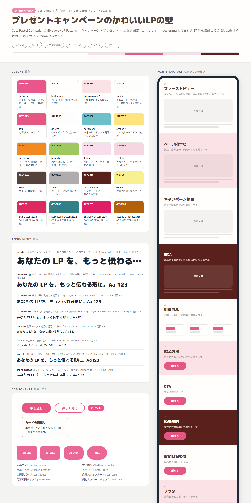</a> | 37 LP analyses | [DESIGN.md](packs/pk-campaign-cute/DESIGN.md) · [preview](packs/pk-campaign-cute/preview.html) · [page](https://designmark.jp/packs/pk-campaign-cute/?utm_source=github&utm_medium=readme&utm_campaign=packs)<br>`pk-campaign-cute` |

## Find more designs

[designmark.jp](https://designmark.jp/?utm_source=github&utm_medium=readme&utm_campaign=packs) publishes 4,148 LP-level DESIGN.md files — one per Japanese landing page, searchable by industry, mood and colour. Pattern packs are also listed on the [packs page](https://designmark.jp/packs/?utm_source=github&utm_medium=readme&utm_campaign=packs).

## What is a pattern pack?

- designmark, operated by XECIN Inc., analyses public Japanese landing pages and publishes one DESIGN.md per page.
- A pattern pack aggregates 20–60 of those DESIGN.md files that share an industry and a main mood (newest first): colour clusters per role (CIEDE2000; a representative colour is the mean of a cluster, never the colour of a single page), type scale distributions, median spacing and radii, frequent components and the typical section order. One DESIGN.md is then synthesised from these statistics only — no screenshots, page URLs or copy are used.
- **A pack is not the design of any specific landing page.** Packs that are too close to a single source (chromatic colours, identical section order or copied sentences) are rejected, and packs contain no logos, product names or copy.
- Packs are reviewed monthly. A retired pack stays in `packs/` but is removed from this list and from `catalog.json`.
- `catalog.json` lists the current packs in the same format as [the packs API](https://designmark.jp/api/v1/packs/index.json).

## Need a custom DESIGN.md or an AI-built LP?

XECIN, the company behind designmark, builds landing pages with AI and creates DESIGN.md files for your own brand and design assets. → [Contact us](https://designmark.jp/consult/?utm_source=github&utm_medium=readme&utm_campaign=packs-consult)

## License

- `packs/` (DESIGN.md and previews) and `catalog.json`: [CC BY 4.0](https://creativecommons.org/licenses/by/4.0/) ([LICENSE](LICENSE)). Attribution example: "Pattern pack by designmark (XECIN Inc.) — https://designmark.jp".
- `scripts/`: MIT ([LICENSE-CODE](LICENSE-CODE)).
- Requests and bug reports: [Issues](../../issues/new/choose). Takedown requests for designmark.jp: https://designmark.jp/takedown/
